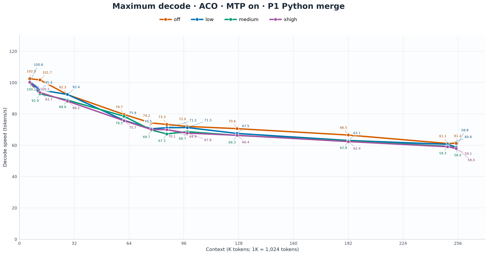

# Qwen3.8-27B at 256K Context on a 16GB GPU, with 9× CPU-Offload Speed

*Attention-Aware Context Offloading keeps long conversations fast with a 64K GPU hot cache and native MTP.*

Last time, I pushed Qwen3.8-27B past 100 tokens per second on a 16GB RTX 4080. The next challenge was keeping that model useful after loading a repository and working through a long conversation. [The earlier 100 tok/s article](https://medium.com/@paulvanliew/i-made-qwen3-8-27b-run-2-5-faster-breaking-100-tok-s-on-a-16gb-rtx-4080-72b6a99d7a42).

I built **ACO — Attention-Aware Context Offloading** to retain a much larger history in system RAM while keeping the active attention working set on the GPU.

The result is **256K context with a 64K GPU hot cache, on the same 16GB card, with native MTP enabled**. The Python code-generation benchmark reaches **102.48 tok/s at small context and 61.23 tok/s near full context**. At the long-context comparison, ACO delivers **8.5–8.9× CPU-offload decode speed** across the three prompts.

## What makes this possible

The speed comes from keeping the model's active attention on the GPU while making the larger history available on demand. Several pieces work together:

- **Attention-aware ranking:** query probes and key reranking choose useful historical pages for the next turn, alongside protected instructions and recent conversation.
- **Millisecond page transfers:** an earlier recall run moved a **33 MiB page bundle in about 5.1 ms of transfer time**. Selection, transfer and publication prepare the turn; generation then uses a stable historical view.
- **Reliable tool conversations:** system instructions, tool definitions, the current goal and a coherent recent conversation stay available as older history becomes cold.
- **GPU-native MTP:** Turbo4 draft KV stays on the GPU, with target/draft rollback and carry state coordinated across page changes.
- **Transparent operation:** the client sends ordinary messages and tool results. ACO manages placement inside the inference server, including evicting completed pages and bringing selected cold pages back.

The practical result is a coding agent that can continue working beyond its GPU hot cache at GPU-like generation speed. Below are the measured curves, followed by the mechanics that make that behavior possible.

## Keeping GPU-like decode speed as context grows

The main graph follows one fixed Python prompt across the context curve. Each point is the **maximum measured decode rate** from the prompt benchmark, with reasoning off and a 400-token output budget.

At small context, ACO reaches **102.48 tok/s**, matching the full-GPU result of **102.46 tok/s**. Around 64K, ACO produces **79.69 tok/s**, compared with **80.70 tok/s** for full GPU and **17.68 tok/s** for CPU KV offload. That is **approximately 99% of GPU speed and 4.5× CPU-offload speed**.

The curve continues through the larger context sizes. ACO reaches **70.61 tok/s around 128K**, **66.52 tok/s at 192K**, and **61.23 tok/s near the end of the 256K fill**. The Bash code-generation prompt follows the same pattern, reaching **64.14 tok/s around 128K** and **60.35 tok/s at 192K**.

The three configuration names in the graphs describe target KV placement. **GPU** keeps it in VRAM, **CPU** keeps it in system RAM, and **ACO** retains the full history in RAM with selected pages hot in VRAM. Model weights are on the GPU in all three. GPU and ACO use Turbo4 target KV. The CPU target cache uses Q4_0, paired with GPU-resident Turbo4 MTP in the branch comparisons.

## Prompt 1 across reasoning modes

ACO maintains similar code-generation throughput across **off, low, medium, and xhigh** reasoning. Near full 256K context, Prompt 1 reaches **61.23 tok/s with reasoning off, 58.79 with low, 58.03 with medium, and 58.03 with xhigh**, with MTP enabled throughout.

## The long-context difference is substantial

At **250K occupied tokens in the 256K configuration**, the three prompts give the following maximum decode speeds.

| Prompt | ACO with MTP | CPU offload with MTP | Speedup |
|---|---:|---:|---:|
| Python sorted-list merge | 61.13 tok/s | 7.21 tok/s | 8.47× |
| mmap versus read | 48.83 tok/s | 5.49 tok/s | 8.89× |
| Bash directory watcher | 55.35 tok/s | 6.50 tok/s | 8.51× |

The Python and Bash prompts exercise code generation, where MTP can accept multiple predicted tokens and accelerate generation. With ACO, that acceleration remains useful even when the retained conversation is several times larger than the GPU hot cache.

For a local coding agent, the difference between roughly **6–7 tok/s and 55–61 tok/s** is immediately noticeable while waiting for code. ACO carries the larger history while preserving much of the generation speed that makes a GPU-hosted model pleasant to use.

## How ACO keeps the working set on the GPU

The model turns input tokens into **keys and values**, or KV, which later tokens use for attention. ACO divides that cache into pages of **256 tokens**. Completed historical pages have canonical backing in system RAM; a bounded working set is resident in GPU VRAM.

New KV rows are computed and written on the GPU. Completed pages are sealed and copied to host backing asynchronously. Once that backing is valid and outstanding GPU consumers have finished, the GPU slot can be reused. Evicting a page therefore releases VRAM while retaining its KV contents and logical position for a later turn.

The measured configuration uses **65,536 hot tokens and 262,144 total context capacity**. Turbo4 is used for the target K/V, its offloaded page storage, and native MTP K/V. MTP keeps its own full-context KV allocation on the GPU.

For this model's geometry, the 64K hot target-KV payload occupies approximately **1.03 GiB**, compared with **4.125 GiB** for 256K of fully GPU-resident target KV. That is **75% less GPU memory for the target-KV payload**.

The full history can remain much larger than the GPU cache because target attention operates on the selected GPU working set. The model weights and attention computation stay on the GPU.

## Ranking: choosing which history deserves GPU space

Ranking is the intelligence behind the cache. ACO uses the incoming query's attention evidence to find useful historical pages, then combines that evidence with the context needed to keep the conversation coherent.

The `probe-rerank` route first uses **four query probes** and compact page summaries to produce a bounded shortlist. It then evaluates keys for shortlisted candidates to refine their page scores. The fuller rerank path measures normalized attention probability mass: how strongly the query attends to a page's keys, including peak and mean evidence across its layer plans. A coarse nomination alone is insufficient to authorize a promotion.

For large input spans on the supported Qwen hybrid architecture, a faster route runs the leading recurrent blocks and the first full-attention layer's query projection against isolated routing state. That supplies an early-layer ranking approximation before the main target prefill. Short recall questions retain richer all-layer evidence. This keeps bulk ingestion efficient while spending more semantic work where a short question may need a specific old detail.

The ranking operates on KV keys, query positions and page summaries. A source file may span several pages, and the relevant section can return without making the whole file hot. Before a selected page can be used, ACO checks its sequence, page generation, content version and summary identity, so an old routing result cannot accidentally name a GPU slot that has since been reused.

## Promotion and eviction: prepare the turn, then generate

When ranking chooses a cold page, ACO locates its host-backed KV and schedules a **host-to-device promotion**. The upload uses bounded staging and asynchronous transfers. The new GPU mapping becomes visible only after the copy completes and its page identity is checked again. Target attention then consumes that published mapping.

In the other direction, eviction chooses pages whose contents are safely backed in RAM and whose GPU users have finished. Protected instructions, selected history and active write pages are excluded from ordinary victims. New input can occupy recycled slots while older completed pages remain retrievable from RAM.

**The data movement itself is small enough to be measured in milliseconds.** In a measured source-file recall run, a batch of eight complete page bundles transferred **33 MiB**, with about **5.1 ms recorded in the page-transfer component**. Ranking and question evaluation are additional turn-setup work. The important scheduling decision is that historical selection is settled at the turn boundary and frozen through generation, including MTP verification. Cold-page ranking is not repeated for every generated token. [File-recall measurement](https://github.com/vanwho/buun-llama-cpp/blob/plan/attention-aware-kv-paging/.wiretail/execution/evidence/NATURAL_FILE_PROMOTION_20261104.md).

Generated output has its own rolling window. Older completed output pages can be sealed and recycled as a long answer advances. With 64K hot context, the automatic window is **16K tokens**; a client's 24K output ceiling does not reserve 24K of VRAM or take that much history out of attention for a short reply. A protected instruction page can remain resident while later output pages continue cycling through the remaining slots.

## Preserving the control state of a long coding session

A coding agent needs more than the latest file contents. It must retain the instructions, tool schemas, current task, preceding tool invocation and enough recent conversation to know what to do next.

ACO protects the **initial system/developer instructions and tool definitions**, prioritizes a small latest user goal, and retains a **contiguous recent conversation window** within the admitted hot budget. Keeping that window coherent preserves the relationship between a tool call and its result. Older pages still compete through attention ranking, and space remains reserved for incoming writes and output.

The implementation follows the **original message roles through the model's native chat template**. This matters because Qwen templates can wrap tool results in user-like delimiters. A file may also contain literal role markers. ACO maps verified source-message ranges to their actual token positions, keeping separate tool rounds and parallel tool results distinguishable without changing the prompt sent to the model.

A separate CPU template render locates those source ranges with temporary markers. Removing the markers must reproduce the original prompt byte for byte before the offsets are accepted. The model receives the original prompt, while the cache controller gets reliable boundaries for the real user request and tool interaction.

For a tool continuation, the query extends through the tool-result closure and the native assistant-response boundary. The routing decision therefore belongs to the point where the assistant is about to act. A partial page shared by history and the new query remains writable; it is not accidentally frozen as old history. These boundaries prevent stale tool state and avoid allocation failures when a long answer rolls beyond its initial output window.

The protection and budgeting use bounded host metadata and the admitted hot capacity. They introduce no second KV pool or generation-token routing pass.

## Keeping native MTP accurate across a changing cache

**Multi-token prediction** lets a draft head propose several upcoming tokens for the target model to verify together. ACO keeps that draft head's full-context Turbo4 KV on the GPU, independently of the target's hot/cold placement. The measured configuration uses **n-max=2**.

The difficult part is keeping the state consistent. Newly written target KV must be visible before a packed attention view reads it. Native token positions, causal masks and valid rows must still agree after page relocation. The historical selection used for target generation stays frozen through speculative verification.

When a proposal is rejected or a query must be replayed, the target, draft and recurrent state must return to a compatible frontier. MTP also carries a target hidden state into its next draft step. Rewinding an otherwise identical cached query invalidates the old prompt-frontier carry before earlier rows are evaluated; a coordinated checkpoint can then restore its matching state. This prevents an apparently valid cache from feeding the draft head state from the wrong point in the conversation.

Those consistency rules preserve the benefit of speculation while pages move. In a recent ten-turn repository/tool validation, all **10 file reports were correct through 83,656 occupied tokens**, beyond the 64K hot cache, and MTP accepted **218 of 224 drafted tokens: 97.3%** across that run.

## A promotion observed in a live coding session

The same behavior is visible during ordinary agent work. At **163,744 occupied tokens**, a live request selected **logical page 266**, covering token positions **68,096–68,351**, while processing a query at position **162,366**. That page was cold and backed by system RAM.

The recorded chain shows the selector ranking it **#1**, authenticating it, completing the host-to-GPU copy, publishing **GPU slot 40**, and recording its use in both the target and MTP continuation graphs. The transaction moved a **33 MiB bundle**. The turn generated **1,370 tokens at 68.41 tok/s**. [Live promotion and validation record](https://github.com/vanwho/buun-llama-cpp/blob/plan/attention-aware-kv-paging/.wiretail/execution/evidence/ACO_ARTICLE_20261111.json).

The client continued using normal messages and tools; the page movement happened inside the server. That is the usability goal: retain a large working history, retrieve useful cold context as the conversation changes, and keep generation responsive after crossing the GPU hot-cache boundary.

The implementation remains selective attention, with query-dependent page choices. The setup guide covers its paging, ranking, GPU attention and state-consistency paths. [ACO implementation and configuration](https://github.com/vanwho/buun-llama-cpp/blob/plan/attention-aware-kv-paging/docs/aco.md).

## GPU MTP also makes CPU offload faster

A related addition improves conventional CPU KV offload. The branch adds **independent native-MTP KV placement**, exposed through `--spec-draft-kv-device gpu`, so the target KV can remain in CPU RAM while Turbo4 draft KV stays on the GPU.

The master native-MTP control inherits the target's CPU KV placement. The graph shows how the independent GPU placement changes its decode performance.

Around 64K context, the Python prompt improves from **15.12 to 17.68 tok/s**, a **16.9% gain**. Around 128K, it improves from **10.12 to 12.02 tok/s**, an **18.8% gain**. The Bash prompt gains **10.5%** around 64K and **17.6%** around 128K.

The main ACO comparison already uses that faster CPU-offload configuration. ACO then moves the active target-attention pages onto the GPU, producing the much larger gains across the long-context curve.

## MTP off shows the underlying offload advantage

With MTP disabled, ACO reaches **37.5 tok/s** across all three prompts at 250K occupied tokens, compared with approximately **3 tok/s** for CPU KV offload. That is **12.6× CPU-offload speed**. With MTP enabled, the same long-context Python benchmark rises to **61.13 tok/s**, which is why the main results use MTP throughout.

## Loading the repository stays fast, too

The prefill curve uses mapped chunks of fresh repository content, added progressively to an occupied context. With MTP enabled, ACO starts at **1,402 tok/s**, measures **817 tok/s around 64K**, and finishes near 256K at **614 tok/s**. At the 64K scale, the full-GPU curve measures **559 tok/s**. These are model prompt-stage rates for the new input chunks. The final ACO append also measures **603 net-new tokens/s over the complete request wall time**.

## Hardware and benchmark settings

The machine has an **RTX 4080 16GB, Ryzen 7950X3D, and 64GB of RAM**, running Linux. The model is **Qwen3.8-27B UD-IQ4_XS**.

The benchmark uses batch/microbatch **1024 / 256**, one sequence, 16 CPU threads, flash attention, greedy sampling, and seed 42. Native MTP uses a maximum draft length of two. Each prompt has a 40-token warmup and three measured repetitions with a **400-token output budget**.

The GPU, ACO, and CPU comparisons use maximum measured decode speeds with reasoning off. The Prompt 1 reasoning graph compares all four reasoning settings using the same maximum-of-three measurement. The three prompts are the original Python sorted-list merge, mmap-versus-read explanation, and Bash directory watcher. Context is loaded from mapped repository chunks and retained for the prompt tests. The data files include the individual measured repetition rates and exact context positions. **1K means 1,024 tokens.**

The accompanying graph pack includes the full curves for all three prompts, ACO with MTP on and off, all four reasoning modes for ACO Prompt 1, the CPU MTP-placement comparison, and the prefill curve. [Graphs and plotted data](https://github.com/vanwho/buun-llama-cpp/tree/plan/attention-aware-kv-paging/docs/aco-figures).

## Open code

ACO makes a larger working history practical on a 16GB desktop GPU while keeping code generation close to GPU speed. I am continuing the work toward larger contexts, including the 1M context goal.

The branch, setup guide, and benchmark material are available publicly. [ACO source](https://github.com/vanwho/buun-llama-cpp/tree/plan/attention-aware-kv-paging) · [Setup guide](https://github.com/vanwho/buun-llama-cpp/blob/plan/attention-aware-kv-paging/docs/aco.md).

This builds on Buun/spiritbuun's work and llama.cpp. Credit also goes to the Qwen team, Daniel Han, Unsloth AI, and the NVIDIA CUDA ecosystem. [Buun](https://github.com/spiritbuun/buun-llama-cpp) · [llama.cpp](https://github.com/ggml-org/llama.cpp) · [Daniel Han](https://www.linkedin.com/in/danielhanchen) · [Unsloth AI](https://www.linkedin.com/company/unsloth/) · [NVIDIA AI](https://www.linkedin.com/showcase/nvidia-ai/).
