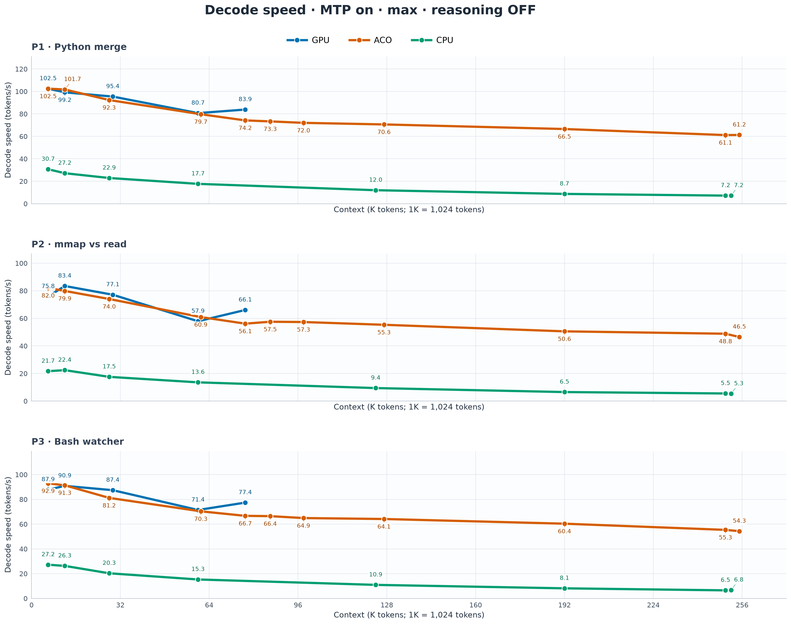
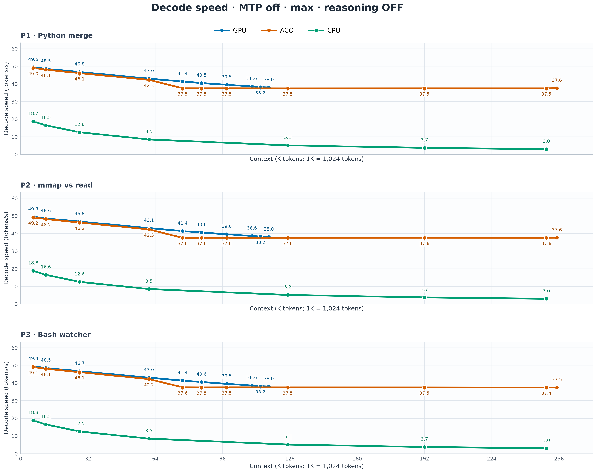
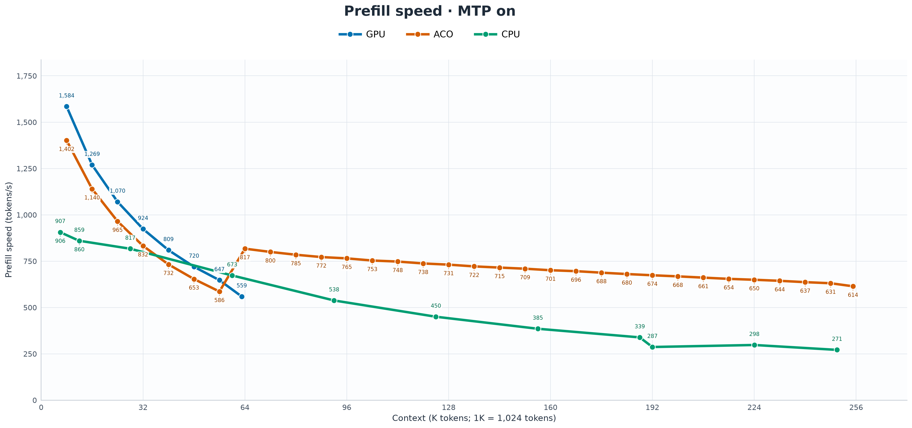
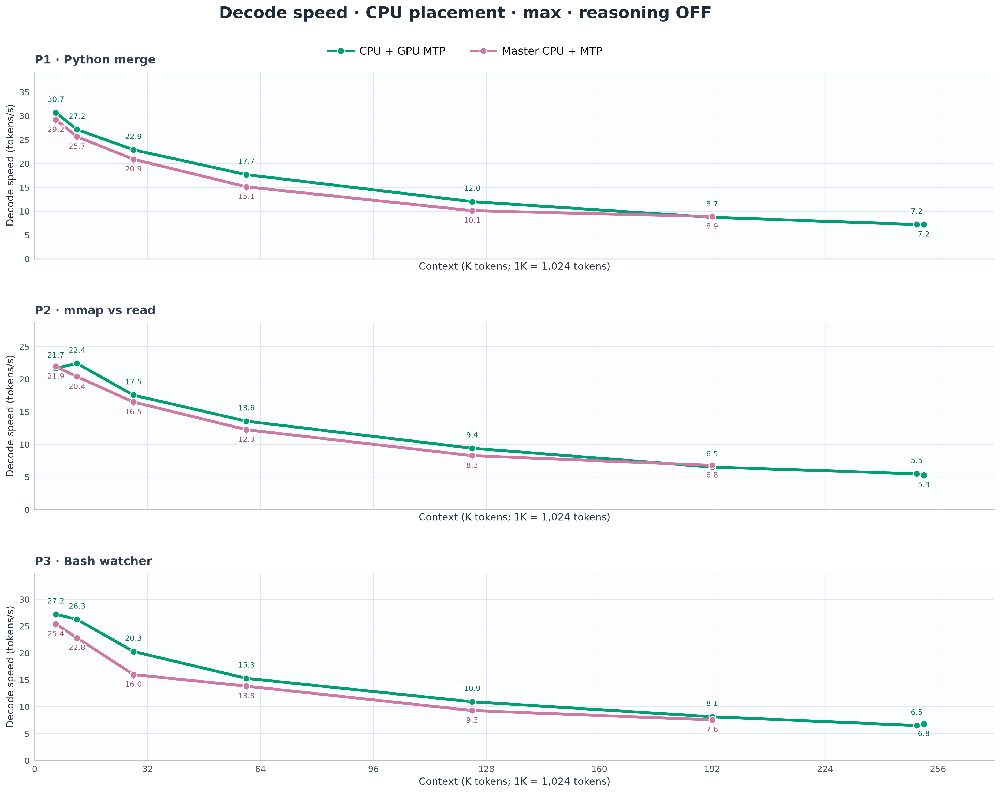

# ACO brings 256K context to a 16GB GPU

**ACO — Attention-Aware Context Offloading** keeps the active part of a model's
KV cache in VRAM and retains the larger context in CPU RAM. On an RTX 4080 with
16GB of VRAM, Qwen3.8-27B UD-IQ4_XS reached **256K context with a 64K GPU hot
cache**, generating up to **61 tokens per second near full context** and
**102 tokens per second at smaller contexts** with native MTP enabled.

At the largest shared benchmark checkpoint, ACO generated text up to **8.9×
faster than CPU KV offload with MTP enabled**. With MTP disabled, the advantage
reached **12.6×**. At smaller contexts, its generation speed closely tracked
the full-GPU configuration. Its latest prefill curve also exceeded the
full-GPU curve as context grew.

## A larger context with a bounded GPU working set

Long context consumes more than storage. Each new token must attend to
historical keys and values. Keeping everything in VRAM eventually reaches
the card's memory limit; moving all target KV to CPU RAM gives capacity but
adds CPU attention work and memory traffic to generation.

ACO divides target KV into pages and keeps a bounded working set on the GPU.
Completed historical pages have compressed backing in host RAM. Attention
evidence guides which pages enter the GPU working set, and cold pages can be
promoted when a new question needs them. Target attention executes over that
selected GPU view.

Selection and promotion happen at the turn boundary. The historical selection
then stays fixed during generation, avoiding a new search through cold history
for every output token. New KV rows are written on the GPU, and completed
pages acquire host backing for later eviction and reuse.

The benchmark configuration used **Turbo4 for target K/V, host page storage,
and GPU-resident MTP K/V**, with a two-token maximum draft. The target hot
cache was 65,536 tokens; total context capacity was 262,144 tokens. Native
MTP has its own GPU allocation, separate from the target hot cache.

## Decode speed stays close to GPU speed

For the Python merge prompt at 6K filled context, ACO reached **102.48 tok/s**,
compared with **102.46 tok/s** for full GPU and **30.69 tok/s** for CPU KV
offload, with MTP enabled in each case.

The advantage over CPU offload grew with context. At 250K occupied tokens in
the 256K configuration, the maximum speeds across three measured repetitions
were:

| Prompt | ACO with MTP | CPU offload with MTP | ACO speed relative to CPU |
|---|---:|---:|---:|
| Python sorted-list merge | 61.13 tok/s | 7.21 tok/s | 8.47× |
| mmap versus read | 48.83 tok/s | 5.49 tok/s | 8.89× |
| Bash directory watcher | 55.35 tok/s | 6.50 tok/s | 8.51× |



ACO also retained its advantage without speculative decoding. At the same
large checkpoint it generated approximately **37.5 tok/s**, compared with
approximately **3 tok/s** for CPU KV offload. At 98K context, it retained
about **95% of full-GPU decode speed**: 37.53 versus 39.54 tok/s on the Python
prompt.



## Prefill remains fast beyond the hot cache

The latest ACO and full-GPU prefill runs loaded new repository content
progressively through the context ladder. Each append added approximately 8K
fresh tokens to the existing context. ACO completed the fill to 256K capacity
with MTP both on and off.

Without MTP, ACO started at **1,589 tok/s** for the first 8K append and reached
**850 tok/s around 128K context**, compared with **318 tok/s** for the full-GPU
curve at that scale. ACO finished the 256K fill at **803 tok/s**. With MTP
enabled, it started at **1,402 tok/s** and finished at **614 tok/s**.




The final ACO append measurements were:

| Configuration | Backend prefill | New tokens per second of request wall time |
|---|---:|---:|
| MTP on | 614 tok/s | 603 tok/s |
| MTP off | 803 tok/s | 783 tok/s |

Backend prefill measures the model's prompt-processing stage. The wall-time
rate measures newly added tokens divided by the complete append request's
elapsed time. The close rates show that these runs spent little additional
time outside the measured prompt-processing stage.

ACO's higher measured rates at larger contexts come with a different attention
workload: full GPU attends over the complete causal history, while ACO uses
the selected GPU working set. The full retained context remains available for
future selection and promotion.

## GPU MTP also helps ordinary CPU offload

A related addition in this branch allows native MTP KV to stay on the GPU
while the target KV cache lives in CPU RAM. The independent
`--spec-draft-kv-device gpu` control separates the two placements; the compared
master native-MTP path inherited the target's CPU KV placement.

This improved even the CPU-offload comparison. Around 64K context, keeping
Turbo4 MTP KV on the GPU produced maximum decode rates of **17.68, 13.56 and
15.29 tok/s** for the three prompts, versus **15.12, 12.26 and 13.84 tok/s**
on master. Around 128K, the branch reached **12.02, 9.42 and 10.93 tok/s**,
versus **10.12, 8.27 and 9.29 tok/s** on master.



ACO's main comparisons therefore use a CPU baseline that already benefits
from GPU-resident MTP. The larger improvement comes from keeping the target
attention working set on the GPU as well.

## Benchmark configuration

The host used an NVIDIA RTX 4080 with 16GB VRAM and an AMD Ryzen 9 7950X3D.
The model was Qwen3.8-27B UD-IQ4_XS. Model layers stayed on the GPU in all
three placements; “CPU” in the graphs means **target KV offload to CPU RAM**.
The CPU target cache used Q4_0. GPU target caches and ACO used Turbo4.

Batch and microbatch sizes were **1024/256**, with flash attention enabled,
one sequence and 16 CPU threads. MTP used a maximum draft length of two.
Generation used greedy sampling, seed 42, one 40-token warmup and three
measured repetitions with a 400-token output budget per prompt.

The three prompts were:

1. write a python function that merges two sorted lists into one sorted list, with docstring.
2. explain the difference between mmap and read for loading large files, one paragraph.
3. write a bash script that watches a directory and prints new files as they appear.

The decode figures show the **maximum measured repetition** for each prompt,
with reasoning off. Prefill uses mapped chunks of fresh repository files,
with the existing context retained as more content arrives. The plotted
values are available as [decode data](aco-figures/data/decode.csv),
[prefill data](aco-figures/data/prefill.csv) and
[CPU MTP placement data](aco-figures/data/cpu-mtp-placement.csv). In context
sizes, **1K means 1,024 tokens**.

## Try ACO

The implementation is on the
[attention-aware context offloading branch](https://github.com/vanwho/buun-llama-cpp/tree/plan/attention-aware-kv-paging).
The [ACO guide](aco.md) describes the architecture and supported model
geometry. Build the CUDA server with 16 parallel jobs:

```bash
cmake -S . -B build-aco -DGGML_CUDA=ON -DCMAKE_BUILD_TYPE=Release -DCMAKE_CUDA_ARCHITECTURES=native && cmake --build build-aco --parallel 16 --target llama-server
```

For the documented Qwen model, this command requests 256K total context,
64K target hot KV and GPU Turbo4 MTP:

```bash
build-aco/bin/llama-server -m /path/to/model.gguf --alias qwen38-aco --jinja --host 127.0.0.1 --port 8080 --api-key-file /path/to/api-keys --device CUDA0 -ngl 999 --fit off -fa on -c 262144 -np 1 -t 16 -tb 16 -ctk turbo4 -ctv turbo4 -b 1024 -ub 256 --spec-type draft-mtp --spec-draft-n-max 2 --spec-draft-kv-device gpu --spec-draft-type-k turbo4 --spec-draft-type-v turbo4 --kv-pager selective --kv-router probe-rerank --kv-page-size 256 --kv-hot-pages 256 --kv-pin-recent 0 --no-context-shift --ctx-checkpoints 0 --cache-ram 0 --no-cache-idle-slots
```
