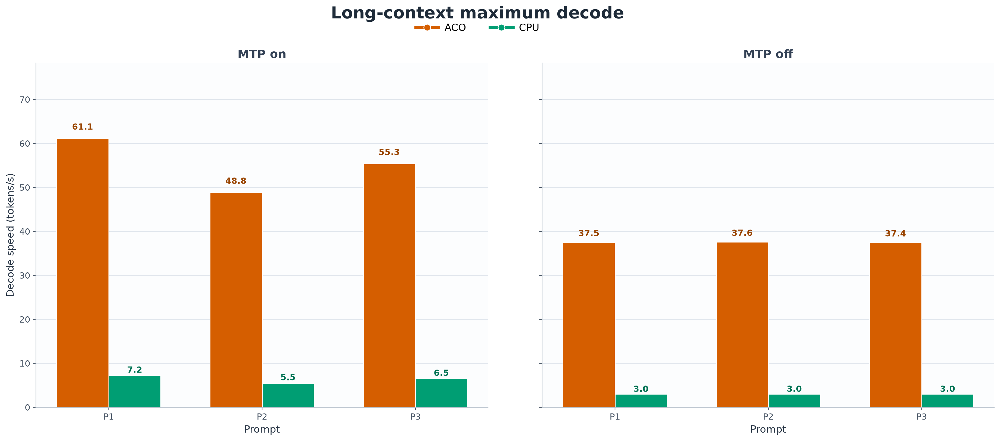
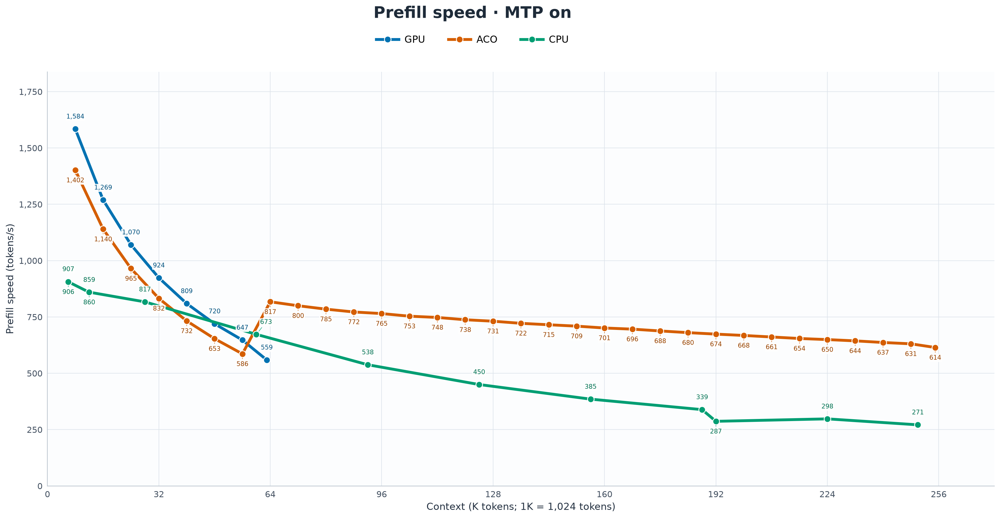
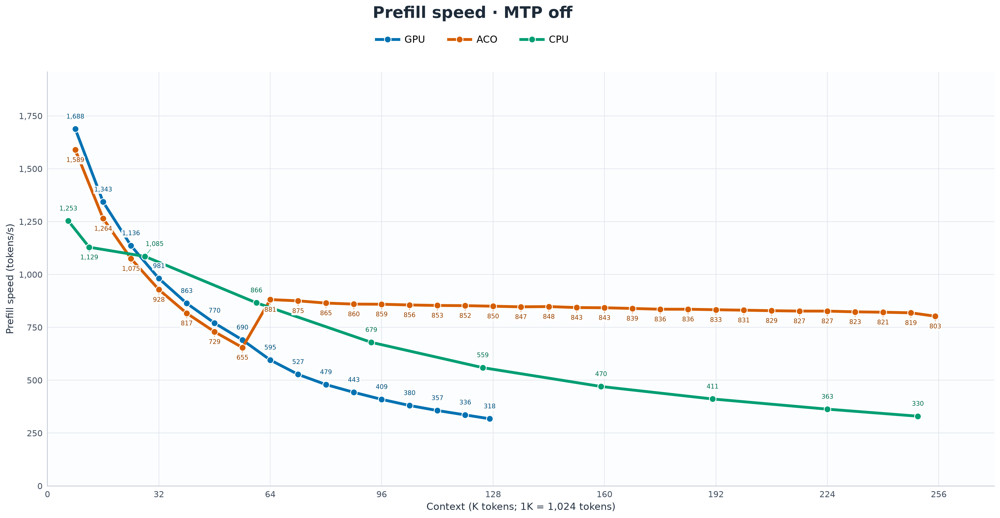

# Qwen3.8-27B: 256K Context on a 16GB GPU — and Up to 12.6× CPU-Offload Decode Speed

*Attention-Aware Context Offloading keeps the history in RAM, the working context on the GPU, and native MTP in the loop.*

Last time, I [pushed Qwen3.8-27B past 100 tokens per second on a 16GB RTX 4080](https://medium.com/@paulvanliew/i-made-qwen3-8-27b-run-2-5-faster-breaking-100-tok-s-on-a-16gb-rtx-4080-72b6a99d7a42). The next problem was less glamorous, but much more familiar to anyone building a local coding agent:

**What happens when the conversation gets big?**

The model fits. The first few turns feel fast. Then you load a repository, keep working, and context starts competing with the model for GPU memory.

I built **ACO — Attention-Aware Context Offloading** to separate those two limits. Retain historical KV pages in system RAM, select the useful working context at the start of a turn, and keep attention and generation on the GPU.

The result is **256K context on the same 16GB card, with a 64K GPU hot cache and native MTP enabled**. The latest results reach **102 tok/s at small contexts and 61 tok/s near full context**. Against CPU KV offload, ACO reaches **8.9× the decode speed with MTP enabled and 12.6× with MTP disabled**.

Prefill has improved substantially, too. ACO finishes the 256K fill at **614 tok/s with MTP on and 803 tok/s with MTP off**. As context grows, its measured input speed can exceed the full-GPU curve.

## First, the numbers that matter

**Around 64K context, the Python prompt reaches 79.69 tok/s with ACO, 17.68 tok/s with CPU KV offload, and 80.70 tok/s with full GPU. That is 4.5× CPU speed and approximately 99% of full-GPU speed.** MTP is enabled in all three configurations.

“CPU offload” means the target model's KV cache lives in CPU RAM. The model weights remain on the GPU. The CPU target cache uses Q4_0; GPU and ACO target KV use Turbo4. The CPU/MTP control also benefits from this branch's GPU-resident draft KV, described below.

The important change is how that comparison evolves as history grows.

## The advantage grows with context

**At 250K occupied tokens in the 256K configuration, ACO reaches 61.13, 48.83 and 55.35 tok/s on the three prompts. CPU KV offload reaches 7.21, 5.49 and 6.50 tok/s.** The corresponding ACO speedups are **8.47×, 8.89× and 8.51×**.

| Prompt | ACO with MTP | CPU offload with MTP | ACO / CPU |
|---|---:|---:|---:|
| Python sorted-list merge | 61.13 tok/s | 7.21 tok/s | 8.47× |
| mmap versus read | 48.83 tok/s | 5.49 tok/s | 8.89× |
| Bash directory watcher | 55.35 tok/s | 6.50 tok/s | 8.51× |

ACO keeps generating at useful interactive speeds as the logical history grows well beyond the GPU hot set. The Python prompt still reaches **61.23 tok/s at the final filled checkpoint**.

These are maximum measured decode speeds. The article's comparisons use the same three prompts with reasoning off; each point takes the fastest measured repetition for that prompt and configuration.

## What ACO changes

Think of RAM as the warehouse and the GPU as the workbench.

ACO retains completed historical KV pages in RAM, uses attention evidence and key reranking to select pages for the incoming turn, and brings those pages into a bounded GPU hot set. Target attention operates over the selected GPU view. Pages outside that view remain available in RAM for future turns.

Selection and promotion happen at the turn boundary. The selected historical set then stays stable during generation, so every output token does not trigger another search through the offloaded history. New KV rows are written on the GPU, and completed pages acquire host backing for later eviction and reuse.

**Keep the history available. Select the working context. Generate on the GPU.**

Turbo4 is used for the ACO target K/V, its host page storage, and native MTP K/V. MTP retains a separate full-context allocation on the GPU. The target hot cache is 65,536 tokens; total context capacity is 262,144 tokens.

The result is selective attention over a GPU working set, rather than dense attention over every retained historical page. The [implementation guide](https://github.com/vanwho/buun-llama-cpp/blob/plan/attention-aware-kv-paging/docs/aco.md) explains the routing and supported geometry.

## MTP off keeps the same advantage

MTP accelerates generation, but ACO's benefit does not depend on speculative decoding.

**At 250K context without MTP, ACO generates approximately 37.5 tok/s across all three prompts, while CPU KV offload is approximately 3 tok/s. The maximum speedup is 12.6×.**

The comparison with full GPU remains close at contexts that fit both configurations. At 98K, for example, the Python prompt reaches **37.53 tok/s with ACO versus 39.54 tok/s with full GPU: about 95% of GPU speed**.

The three prompts exercise different generation patterns: Python code, a prose explanation, and a Bash script. The advantage over CPU KV offload appears across all three, with MTP both on and off.

## Prefill now stays fast as the repository grows

Loading source code matters just as much as generating a reply. I load mapped chunks of fresh repository content, retain the existing context, and add more files as the context ladder grows.

The latest ACO and full-GPU runs add approximately **8K fresh tokens per step**, keeping batch and microbatch at **1024 / 256**. ACO completes the fill through 256K capacity with a 64K hot cache in both MTP settings.

**With MTP on, ACO starts at 1,402 tok/s for the first 8K append and finishes at 614 tok/s near 256K.** Its measured rate around 64K is **817 tok/s**, compared with **559 tok/s** on the full-GPU curve at that scale.

**With MTP off, ACO starts at 1,589 tok/s and finishes at 803 tok/s near 256K. Around 128K, ACO reaches 850 tok/s versus 318 tok/s on the full-GPU curve — about 2.7× the rate.**

At the final ACO append, the measured prompt-stage and request-wall rates are close:

| Configuration | Backend prefill | Net-new tokens / request wall time |
|---|---:|---:|
| ACO, MTP on | 614 tok/s | 603 tok/s |
| ACO, MTP off | 803 tok/s | 783 tok/s |

Backend prefill measures model prompt-processing time. The wall-time rate measures newly added tokens divided by the complete append request's elapsed time. These curves measure how quickly new repository content enters an already occupied context.

The full-GPU path attends over the complete causal history; ACO uses its selected GPU working set while retaining the larger history in RAM. That distinction is central to carrying more context without making the active attention view grow with every retained page.

## A useful addition for CPU offload, too

One related improvement helps the CPU baseline itself: **independent native-MTP KV placement**.

The branch adds `--spec-draft-kv-device gpu`, allowing CPU-resident target KV to pair with GPU-resident Turbo4 draft KV. The native-MTP interface used by the master control inherited the target's CPU KV placement instead.

**Around 64K context, maximum decode rates are 17.68, 13.56 and 15.29 tok/s with GPU-resident MTP, versus 15.12, 12.26 and 13.84 tok/s on master — gains of roughly 10–17%. Around 128K, the gains are roughly 14–19%.**

This means ACO is compared against a CPU-offload configuration that already benefits from accelerated GPU MTP. Keeping the target attention working set on the GPU delivers the larger improvement shown in the main graphs.

## Making the fast path fit

The desktop is the same class of machine as before: **RTX 4080 16GB, Ryzen 7950X3D, 64GB RAM, and Linux**. The model is **Qwen3.8-27B UD-IQ4_XS**. The common settings are one sequence, 16 CPU threads, flash attention, and batch/microbatch **1024 / 256**. Native MTP uses a maximum draft length of two.

The engineering after the first working version mattered. The branch now combines query-boundary selection, host-backed page lifecycles, bounded transfers, and GPU attention routes for the selected working set. Bulk input avoids unnecessary full-model replay when the attention view can be reused safely. Supported Turbo4 prefill stays on fused GPU attention paths instead of creating a large intermediate F16 KV copy.

The benchmark uses greedy sampling, seed 42, one 40-token warmup and three measured repetitions with a 400-token output budget for each prompt:

1. write a python function that merges two sorted lists into one sorted list, with docstring.
2. explain the difference between mmap and read for loading large files, one paragraph.
3. write a bash script that watches a directory and prints new files as they appear.

The figures show maximum measured repetitions with reasoning off. Context values use **1K = 1,024 tokens**. The [plotted data and renderer](https://github.com/vanwho/buun-llama-cpp/tree/plan/attention-aware-kv-paging/docs/aco-figures) are available alongside the code.

## Why this changes the hardware conversation

For the documented Turbo4 geometry, a 64K hot target-KV payload is approximately **1.03 GiB**. Keeping 256K of that target KV fully resident would require **4.125 GiB**. ACO retains the larger history while using **75% less GPU memory for the target-KV payload**.

For local and on-premises users, the opportunity is concrete: retain a more capable model and a longer useful history on an existing card, with generation speeds much closer to the GPU path than to conventional CPU KV offload.

For serving systems, separating retained history from active GPU state also creates room to explore more efficient memory sharing and scheduling. The work here establishes the single-sequence path; broader serving and model coverage are useful next directions.

## Open code

The [ACO branch](https://github.com/vanwho/buun-llama-cpp/tree/plan/attention-aware-kv-paging), [results and graphs](https://github.com/vanwho/buun-llama-cpp/blob/plan/attention-aware-kv-paging/docs/aco-article.md), and [setup documentation](https://github.com/vanwho/buun-llama-cpp/blob/plan/attention-aware-kv-paging/docs/aco.md) are available now.

This builds on [Buun/spiritbuun's work](https://github.com/spiritbuun/buun-llama-cpp) and [llama.cpp](https://github.com/ggml-org/llama.cpp). Credit to the Qwen team, [Daniel Han](https://www.linkedin.com/in/danielhanchen) and [Unsloth AI](https://www.linkedin.com/company/unsloth/) for the earlier quantization foundation, and the [NVIDIA AI](https://www.linkedin.com/showcase/nvidia-ai/) CUDA ecosystem behind this implementation.

Last time, the question was how fast a useful local model could run.

**This time, it is how much history we can retain while keeping that model fast.**
