# ACO publication graph gallery

[Read the article](../aco-article.md). All decode charts use maximum measured repetitions with reasoning off.

## MTP on at 64K-class context

On the P1 Python prompt, ACO measured 79.69 tokens/s: 4.5× CPU at 17.68 and 99% of GPU at 80.70.

[SVG](figures/01_mtp_64k_comparison.svg)

## MTP-on decode across context lengths

Near 250K context, ACO measured 61.13, 48.83, and 55.35 tokens/s on P1–P3, versus CPU at 7.21, 5.49, and 6.50: 8.47–8.89× CPU speed.

[SVG](figures/02_mtp_context_comparison.svg)

## MTP on · P1 Python merge

On P1, ACO measured 102.48 tokens/s at 6K, 70.61 at 128K, and 61.23 near 256K.

[SVG](figures/03_mtp_prompt_1.svg)

## MTP on · P2 mmap vs read

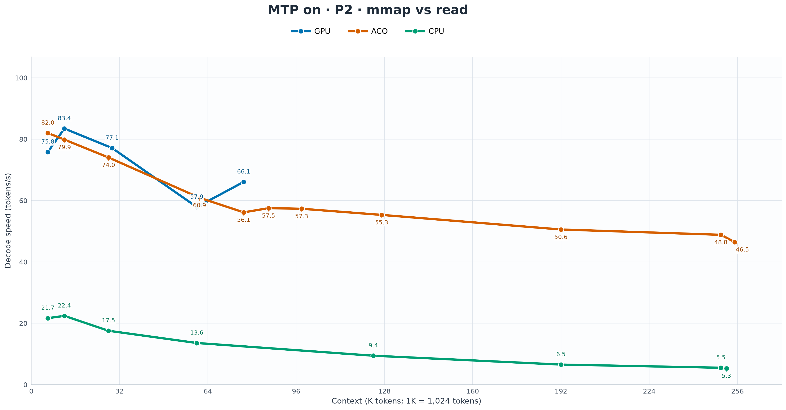

Near 250K on P2, ACO measured 48.83 tokens/s versus CPU at 5.49: 8.89× CPU speed.

[SVG](figures/04_mtp_prompt_2.svg)

## MTP on · P3 Bash watcher

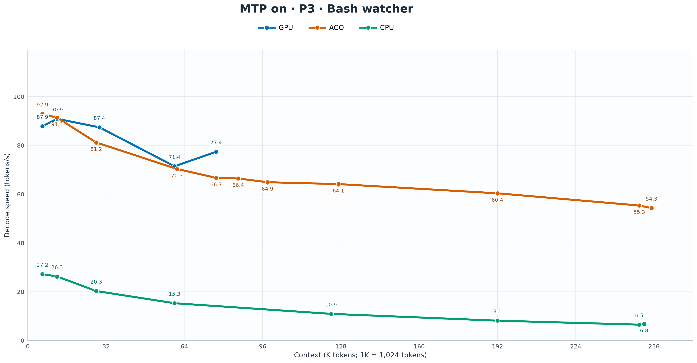

Near 250K on P3, ACO measured 55.35 tokens/s versus CPU at 6.50: 8.51× CPU speed.

[SVG](figures/05_mtp_prompt_3.svg)

## MTP off at 62,464 tokens

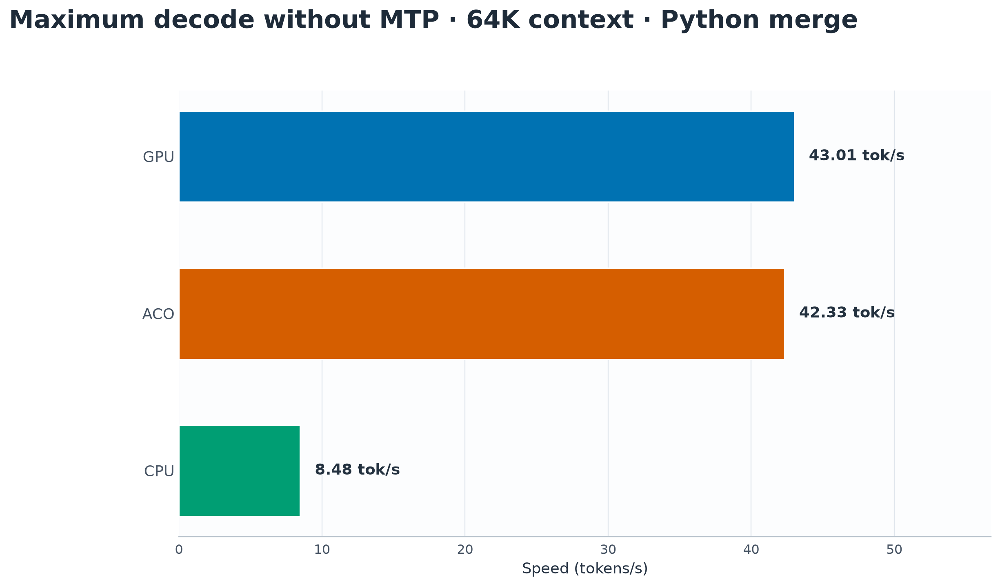

On P1, ACO measured 42.33 tokens/s versus CPU at 8.48 and GPU at 43.01: 5.0× CPU speed and 98% of GPU speed.

[SVG](figures/06_non_mtp_64k_comparison.svg)

## MTP-off decode across context lengths

Near 256K, ACO measured about 37.5 tokens/s across P1–P3, versus CPU at about 3.0 tokens/s.

[SVG](figures/07_non_mtp_context_comparison.svg)

## ACO decode · MTP on versus off

On P1 near 256K, ACO measured 61.23 tokens/s with MTP on and 37.59 with MTP off.

[SVG](figures/08_aco_mtp_on_off.svg)

## MTP off · P1 Python merge

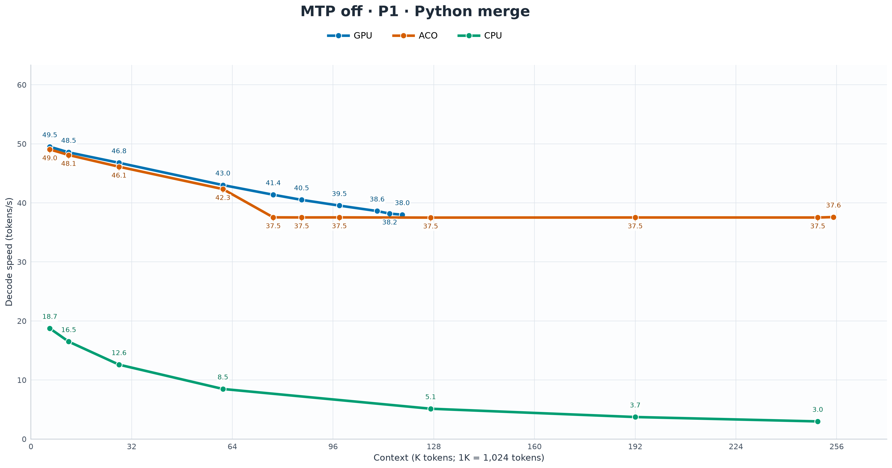

Near 250K on P1, ACO measured 37.51 tokens/s versus CPU at 2.98: 12.6× CPU speed.

[SVG](figures/09_non_mtp_prompt_1.svg)

## MTP off · P2 mmap vs read

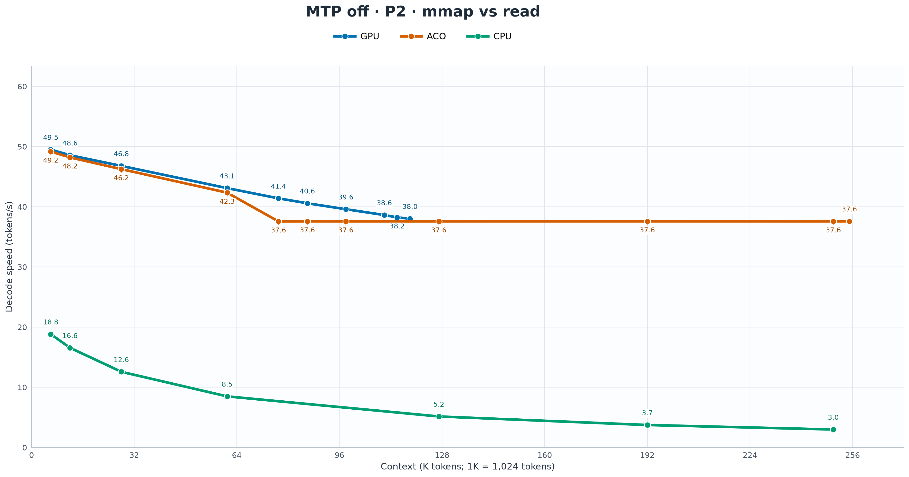

Near 250K on P2, ACO measured 37.57 tokens/s versus CPU at 2.98: 12.6× CPU speed.

[SVG](figures/10_non_mtp_prompt_2.svg)

## MTP off · P3 Bash watcher

Near 250K on P3, ACO measured 37.45 tokens/s versus CPU at 2.98: 12.6× CPU speed.

[SVG](figures/11_non_mtp_prompt_3.svg)

## CPU MTP placement

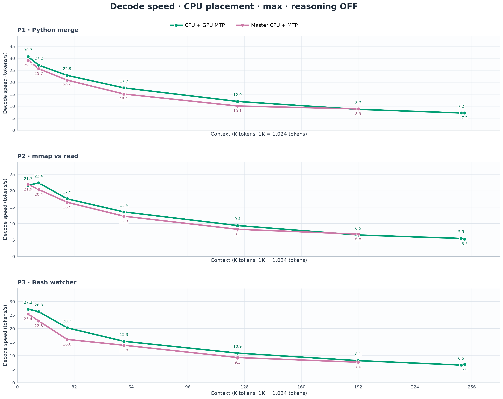

Around 64K on P1–P3, CPU + GPU MTP measured 17.68, 13.56, and 15.29 tokens/s; master CPU + MTP measured 15.12, 12.26, and 13.84. Around 128K, CPU + GPU MTP measured 14–19% higher.

[SVG](figures/12_cpu_mtp_placement.svg)

## MTP-on prefill at 32K target

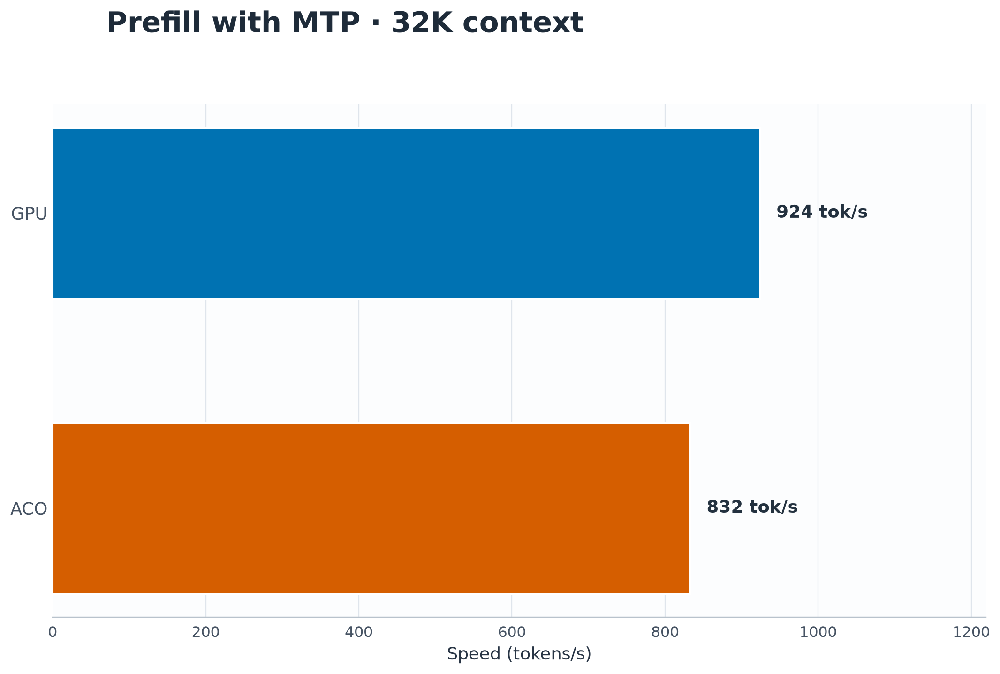

At 32K, GPU measured 924 and ACO 832 fresh tokens/s; ACO reached 90% of the GPU rate.

[SVG](figures/13_prefill_mtp_on_32k_comparison.svg)

## MTP-on prefill across context lengths

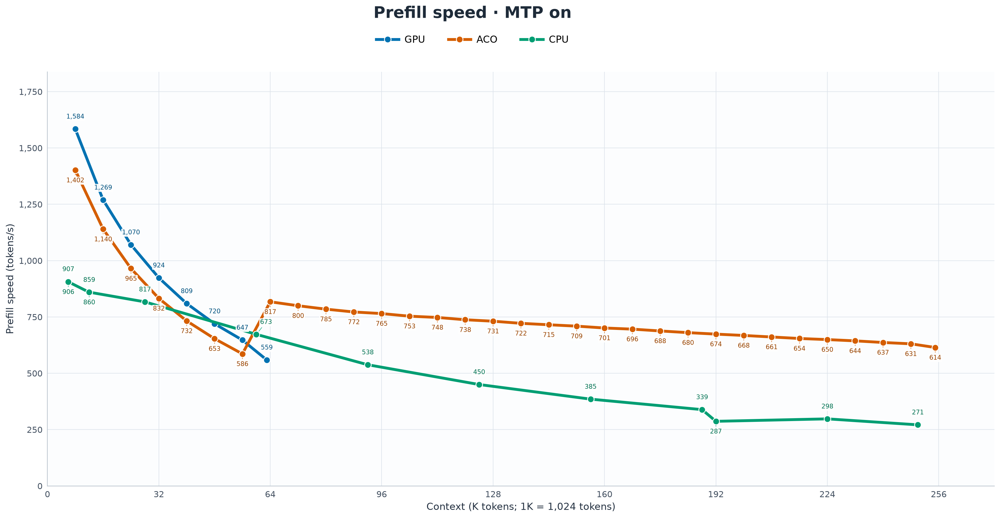

ACO measured 1,402 fresh tokens/s on the first append and 614 near 256K. Around 64K, ACO measured 817 versus GPU at 559.

[SVG](figures/14_prefill_mtp_on_context.svg)

## Prefill without MTP · 128K context

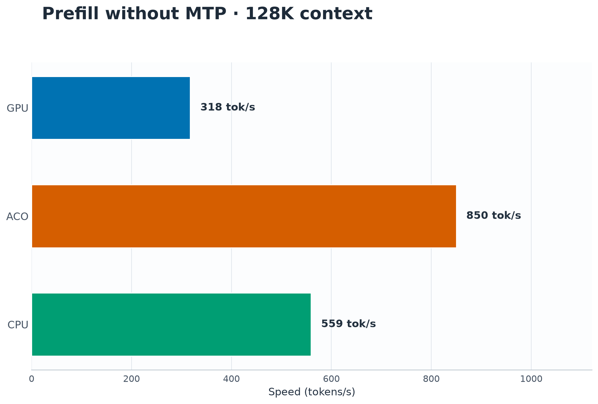

Near 128K, ACO measured 850 fresh tokens/s, CPU 559, and GPU 318; ACO reached 2.7× the GPU rate.

[SVG](figures/15_prefill_mtp_off_128k_comparison.svg)

## MTP-off prefill across context lengths

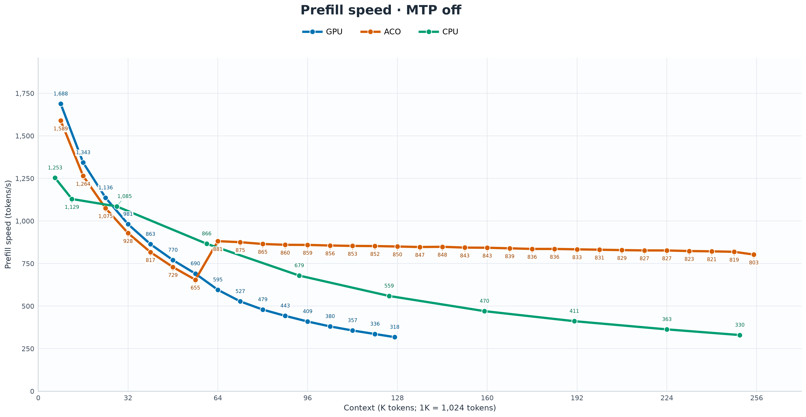

ACO measured 1,589 fresh tokens/s on the first append and 803 near 256K.

[SVG](figures/16_prefill_mtp_off_context.svg)

## Long-context maximum decode

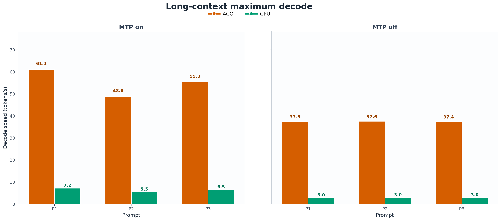

At 250K filled context, ACO measured 8.47–8.89× CPU speed with MTP on and 12.55–12.59× with MTP off across P1–P3.

[SVG](figures/17_long_context_decode_comparison.svg)
