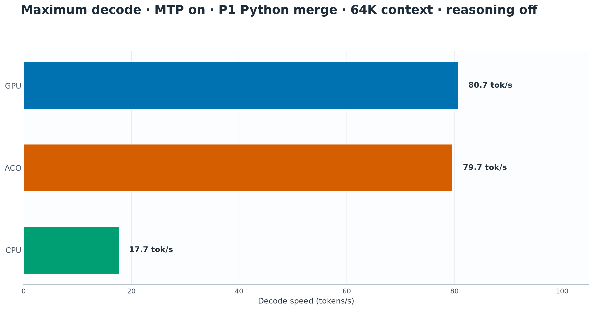
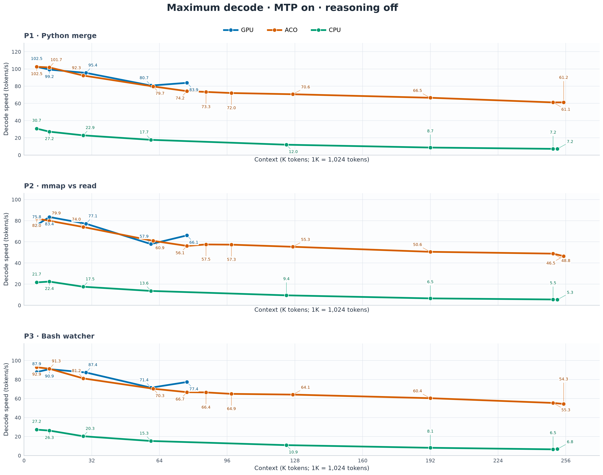
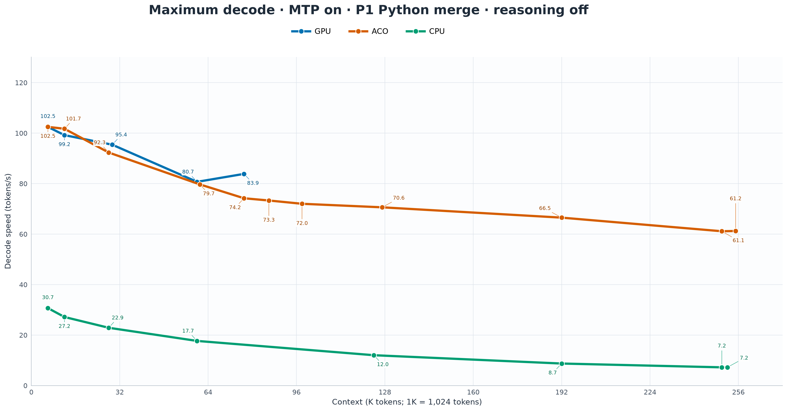
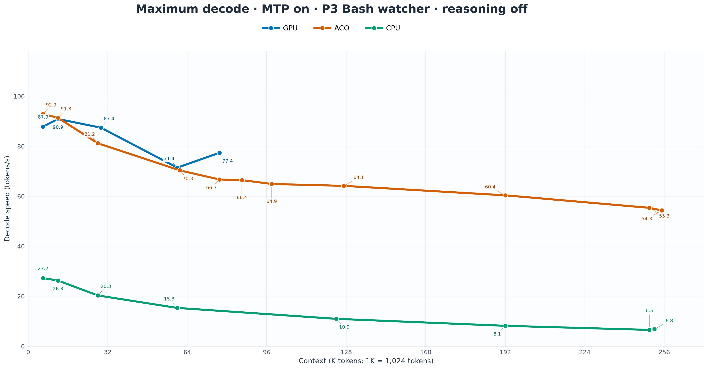
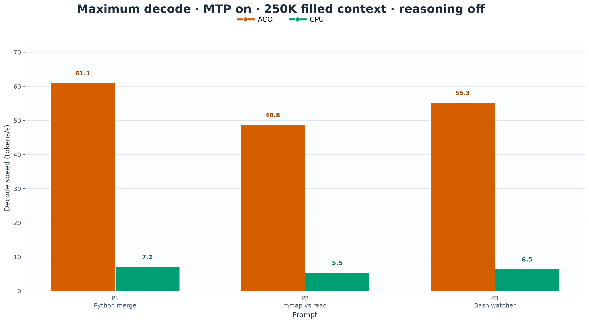
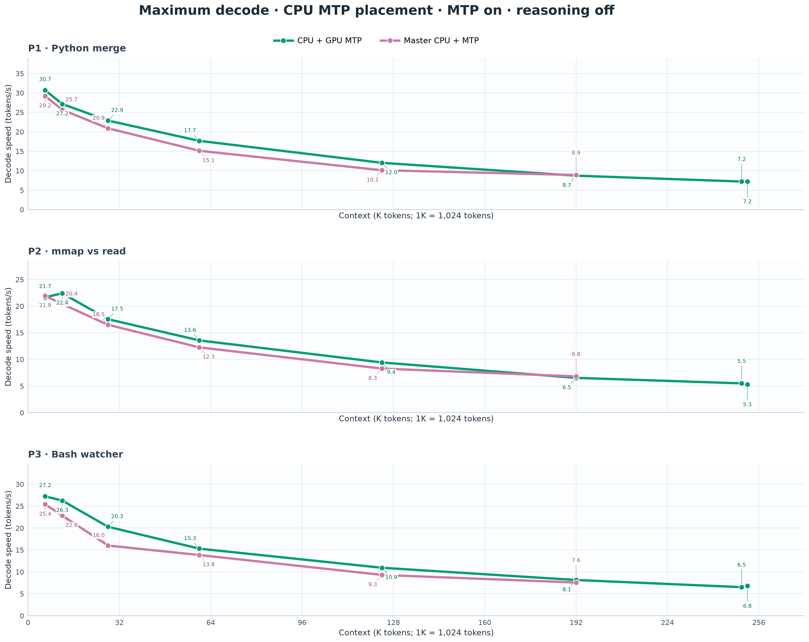
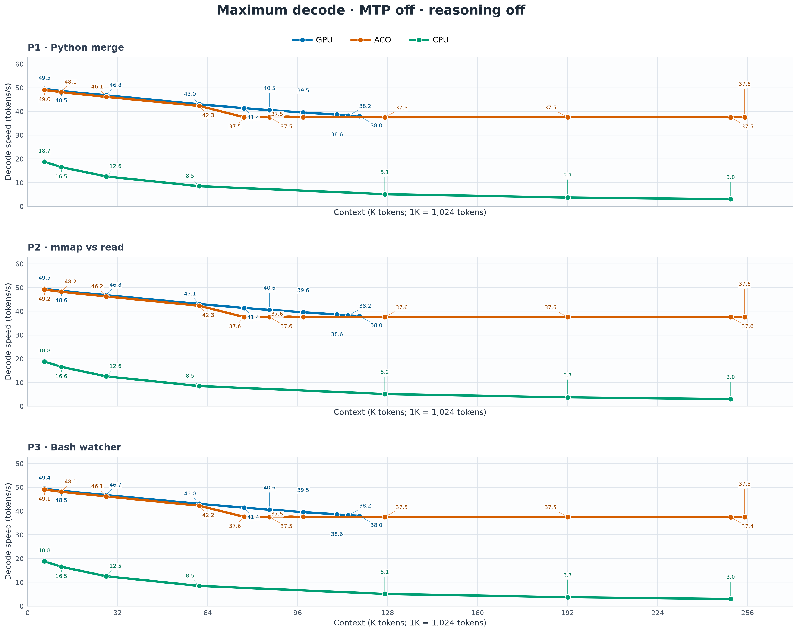
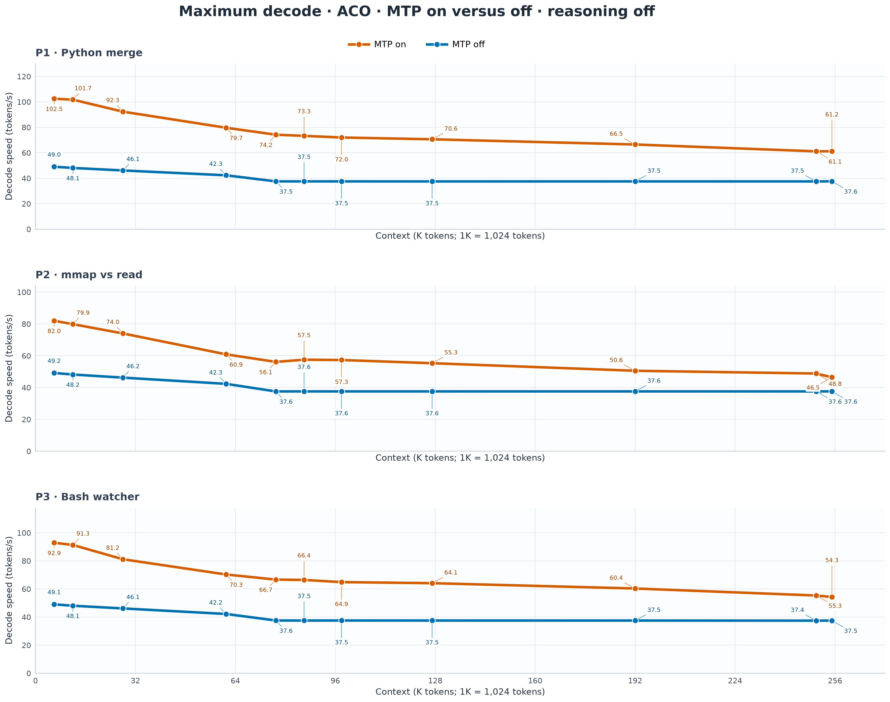
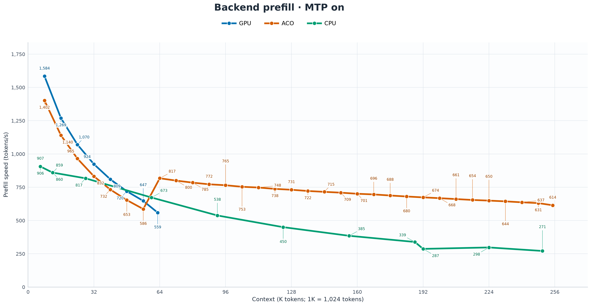
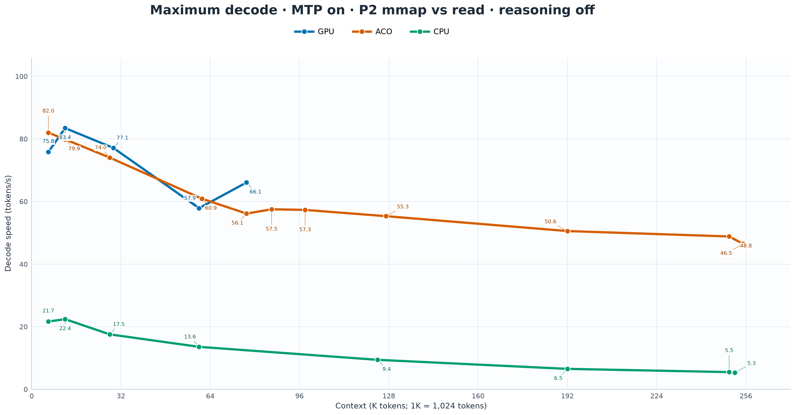

# ACO graphs and captions

Maximum decode results from the three prompt benchmarks, with reasoning off and a 400-token output budget. Each point uses the fastest of three measured repetitions. The final prefill figure follows fresh repository chunks.

## Maximum decode with MTP on around 64K context

Around 64K on P1, ACO reached 79.69 tokens/s, GPU reached 80.70, and CPU reached 17.68.

## Maximum decode with MTP on across prompt types

At 250K filled context, ACO measured 61.13, 48.83, and 55.35 tokens/s on P1, P2, and P3, compared with CPU at 7.21, 5.49, and 6.50.

## Maximum decode with MTP on for P1 Python merge

ACO measured 102.48 tokens/s at 6K context and 61.23 tokens/s near full 256K context on P1.

## Maximum decode with MTP on for P3 Bash watcher

ACO measured 92.93 tokens/s at 6K context and 55.35 tokens/s at 250K filled context on P3.

## Maximum decode with MTP on at 250K filled context

At 256,000 occupied tokens, ACO measured 61.13, 48.83, and 55.35 tokens/s across P1, P2, and P3.

## Maximum decode by CPU MTP placement

Around 64K on P1, CPU + GPU MTP measured 17.68 tokens/s and master CPU + MTP measured 15.12, a 16.9% gain.

## Maximum decode with MTP off across prompt types

At 250K filled context, ACO measured 37.51, 37.57, and 37.45 tokens/s on P1, P2, and P3.

## Maximum ACO decode with MTP on and off

At 250K filled context on P1, ACO measured 61.13 tokens/s with MTP on and 37.51 tokens/s with MTP off.

## Backend prefill with MTP on across context lengths

With MTP on, ACO ingested fresh repository chunks at 1,402 backend tokens/s on the first 8K append and 614 tokens/s near full 256K context.

## Maximum decode with MTP on for P2 mmap vs read

ACO measured 82.01 tokens/s at 6K context and 48.83 tokens/s at 250K filled context on P2.
