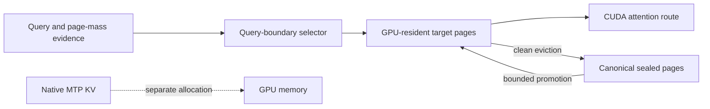

# ACO: Attention-Aware Context Offloading

ACO is an experimental CUDA path for keeping a bounded target-model KV working
set on the GPU while retaining sealed target pages in host memory. The default
`--kv-pager off` path is unchanged. ACO is not a general replacement for dense
attention, and `--kv-pager selective` is an approximation: pages outside the
selected set do not contribute to that attention result.

## Architecture



Target K/V is divided into logical pages. The pager keeps a bounded hot set on
the GPU, while canonical sealed pages and their metadata live in pageable host
memory. A pinned transfer ring stages bounded copies. Clean eviction can drop
device residency after host backing and the routing summary are current. The
pager does not own recurrent state or native MTP K/V; native MTP uses a separate
full-context allocation when enabled.

Attention evidence and retrieval determine which history pages are selected at
a query boundary. The selected history is frozen for that turn. A page being
resident is not proof that a particular attention operation read it; residency,
selection, and actual kernel execution are separate facts. For an eligible
CUDA shape, execution can use contiguous dense Flash Attention, a packed
selected-page view followed by mature Turbo4 Flash Attention, or the direct
paged Turbo4 kernel. `selected_reference` is an explicit correctness
diagnostic. It is not an automatic fallback and its timing is not performance
evidence.

## Supported shape and limits

The documented target geometry is Qwen3.8-family CUDA attention with 256-token
pages, 16 full-attention layers, 4 KV heads, K/V width 256, and Turbo4 K/V
(4.125 bits/value). A complete cross-layer target page is 4,325,376 encoded
bytes (4.125 MiB). The current documented execution boundary is causal,
batch-one CUDA attention. Do not infer support for Qwen3Next or other model
families from this geometry.

Selective routing can differ from full-context dense output and needs
model-and-prompt quality evaluation. It is not dense-equivalent. CUDA
correctness for a selected route does not establish output quality relative to
dense attention. Likewise, a page being GPU-resident does not establish that
it was attended in a measured request.

The hot-page count is a cap resolved against the target context and runtime
memory ledger. GPU memory must also fit model weights, graph and scratch space,
recurrent state, transfer staging, and any native MTP allocation. Host RAM must
fit the sealed-page backing and metadata. Pinned memory is separately bounded
by the transfer ring. `--fit off` disables automatic fitting; use it only when
you have checked the complete allocation on the target device. Unsupported
shapes, missing host backing, stale identities, unsafe eviction, or inadequate
capacity are refused rather than routed through CPU Turbo4 attention.

The available modes are `off`, `observe`, `selective`, and `exact`. `off` is
the normal dense path. `observe` collects pager evidence without selective
eviction. `selective` enables the supported selective route. `exact` requires
its exact-mode invariants and fails closed when they are not met. The optional
`--kv-router probe-rerank` selects query-boundary reranking; the default is
`legacy`.

## Automatic attention reuse

For text chat, ACO obtains source-message ranges from the rendered template,
including templates which wrap tool results in user-role delimiters. Temporary
markers are used only in a separate CPU template render: they are removed and
the result must exactly match the original prompt before any range is accepted.
The model receives the original prompt. Literal role delimiters in files and
repeated text cannot select an older question. Consecutive tool results form the
current query; a tool continuation does not restart routing from token zero.
Unsupported ambiguous chat layouts are reported explicitly instead of silently
treating the whole conversation as a new query.

The initial instruction prefix, including system/developer instructions and
tool schemas, remains in GPU attention. A small latest user goal and a contiguous
recent resident conversation receive an additional allowance of at most half of
the admitted hot pages, after reserving space for the current query and generation.
The suffix is fitted newest-first to the actual history budget; a portion of that
budget remains available for attention-ranked older pages. Already-cold recent
messages remain ranking candidates rather than causing a second transfer path.
Retention is bounded host metadata, evaluated at request boundaries; it does not
allocate another K/V pool or add a generation-token synchronization. Protected
pages participate in the existing authenticated transfer/publication path.
An instruction prefix which cannot fit together with the required write space
produces a capacity error rather than being silently evicted. The configured
hot-page count is a maximum; actual admission may be smaller.

Automatic generation-tail sizing starts with one quarter of admitted H, capped
at 16K tokens, inside the existing hot pool. A bounded longer answer grows that
allowance toward its requested output size, up to half of H. This keeps a useful rolling window
of the current answer/reasoning instead of the former one-page default. The
remaining pool supports selected history; shorter subsequent requests restore
the ordinary allowance, and explicit generation-tail settings
continue to take precedence. This changes no total K/V or scratch allocation.
The generation allowance is a rolling current-query/output window. Query pages
which fit that window are not charged again to the historical allowance; only
query pages beyond the window reduce it. Physical target admission still checks
the complete resident set against H.

Selective ACO handles ordinary requests without an ingestion mode or file
classification. Existing prefix caching and authenticated message boundaries
remain the source of token continuity and query positions. A changed file is
new text, regardless of its name; no file registry or content hashing is added.

When the complete request, its bounded output and speculative lookahead fit
the admitted attention capacity, ACO checks that the existing causal prefix
has valid GPU-resident rows with consistent ownership and representation.
It then consumes the full causal view through prefill, decode and native MTP,
using the existing CUDA dense/packed/direct machinery as appropriate. It skips
query routing and avoids a second pass when the completed view is certified.
An unbounded output request or incomplete/cold prefix retains selective routing.
Eligibility is rechecked after cache restoration before the query is evaluated.

For larger requests, the first query pass and replay/generation use one R+Q
rule: selected prior history R plus the bounded recent current-message/output
window Q. Selector nominations are ranking evidence, not a second provisional
attention policy. Actual successful prefill submissions establish a bounded
CPU metadata certificate of historical page identities, content versions and
causal query coverage. Commit fences those graphs before trusting the certificate.
Physical relocation, table epochs and invisible future pages do not force
replay. Normal Q-window rollover is allowed; a changed/missing historical page,
unproven coverage, content edit or representation change retains replay.

For tool continuations the query includes the native assistant response boundary,
not only the final code token in a tool payload. The retained conversation also
includes the assistant invocation which produced the result. Existing view
certificates avoid replay when the selected history is unchanged. This does not
add routing work during generation.

For supported single-sequence text Qwen35 hybrid requests using
`--kv-router probe-rerank` and larger than one configured batch, ACO can prepare
history before the real target prefill. An
internal graph runs only the leading recurrent blocks and first full-attention
layer's Q projection, using an isolated active recurrent state. Four bounded
query probes rank compatible keys in that source layer; the existing
authenticated transaction promotes complete logical page bundles across all
target attention layers. Target prefill then runs once under the frozen map.
This is an early-layer ranking approximation, explicitly distinguished from
all-layer exact-key mass. It does not duplicate model weights, full-context KV,
MTP state or prompt-length hidden activations. For the documented model its
persistent leading state is about 9.35 MiB; graph scratch is shared.

Short recall questions keep all-layer query evidence: a matched test found a
retrieval miss when using the early proxy for those questions. Unsupported
architectures/owners keep their existing path, including native sparse
indexers. These decisions are automatic and do not introduce an API ingestion
mode or depend on file names. A failure before publication discards provisional
scratch state; a failed publication fails the request rather than mixing maps.

Recurrent state and native-MTP carry remain live when reuse is proven. Required
replay still uses the existing joint checkpoint/restore path. Cached user-span
rows that lack a certificate for the new request are evaluated from the existing
user seam so a partial cached query cannot bypass its checkpoint or proof.
Exact attention retains its existing full-coverage contract, and pager-off and
observe requests retain their existing behavior.

No tensor readbacks, additional model pass, per-file lookup or generation-token
trace is used for the all-hot certificate decision. The early path adds only
its leading-block prepass, not a second full-model pass. Certificate storage is bounded by the hot-page
capacity and uses host metadata; it does not copy K/V or allocate GPU buffers.

## Measured results

The [ACO article](aco-article.md) presents the maximum-speed comparisons and
current graphs. On an RTX 4080 with Qwen3.8-27B UD-IQ4_XS, ACO reached
256K total context with 64K target hot KV, Turbo4 target and draft K/V,
B/U=1024/256 and native MTP n-max=2.

At the final filled checkpoint, C=261,121, maximum decode speeds with reasoning
off were:

| Variant | Python merge | mmap versus read | Bash directory watcher |
|---|---:|---:|---:|
| MTP on | 61.23 tok/s | 46.46 tok/s | 54.29 tok/s |
| MTP off | 37.59 tok/s | 37.59 tok/s | 37.47 tok/s |

At the shared 250K filled checkpoint, ACO's maximum decode rates were
8.47–8.89 times the CPU Q4_0 target-offload rates with MTP enabled and
12.55–12.59 times the rates with MTP disabled. At small contexts, ACO reached
102.48 tok/s on the Python prompt with MTP, compared with 102.46 tok/s for
full GPU.

The latest November 6 prefill runs used a fresh server per configuration and
new repository-content appends in 8K increments. Both ACO curves completed
32 appends through C=261,121. Their final append rates were:

| Variant | Backend prefill | Net-new request-wall rate |
|---|---:|---:|
| MTP on | 614.39 tok/s | 602.92 tok/s |
| MTP off | 802.51 tok/s | 783.04 tok/s |

At approximately 128K context, the MTP-off ACO curve measured 849.79 tok/s
versus 317.56 tok/s for the full-GPU curve. The plotted values are in the
[publication data](aco-figures/README.md), with all retained points shown.

The complete generation matrix covers three canonical prompts and four
reasoning modes, with one 40-token warmup and three measured requests using
a 400-token output budget per cell. The [publication CSVs](aco-figures/README.md)
contain the plotted rates and recorded decode repeat values. Their
[manifest](aco-figures/data/manifest.json) defines the metrics and records
data and figure hashes.

## Build

Use the CUDA toolkit and CMake versions required by
[`docs/build.md`](build.md#cuda). Configure a Release build for the local CUDA
architecture and build the server:

```bash
cmake -B build-aco \
  -DGGML_CUDA=ON \
  -DCMAKE_BUILD_TYPE=Release \
  -DCMAKE_CUDA_ARCHITECTURES=native
cmake --build build-aco --target llama-server -j16
```

The resulting executable is `build-aco/bin/llama-server`. Use a supported
CUDA device and a Qwen3.8-family model with the documented KV geometry. The
generic build command does not imply that every CUDA card can hold a particular
model, hot set, or MTP allocation.

## Launch

The following is a validation configuration for a CUDA device with enough
memory for the complete model, runtime, a 64K-token target hot set, and
full-context native MTP. It is not a universal preset. With 256-token pages,
`--kv-hot-pages 256` caps the target hot set at 65,536 tokens. A model path and
API-key file must be supplied by the operator:

```bash
MODEL=/path/to/qwen3.8-model.gguf
API_KEY_FILE=/path/to/llama-api-keys

build-aco/bin/llama-server \
  -m "$MODEL" \
  --host 127.0.0.1 \
  --api-key-file "$API_KEY_FILE" \
  --device CUDA0 \
  -ngl 999 \
  --fit off \
  -fa on \
  -c 262144 \
  -b 1024 \
  -ub 256 \
  -np 1 \
  -ctk turbo4 \
  -ctv turbo4 \
  --spec-type draft-mtp \
  --spec-draft-n-max 2 \
  --spec-draft-kv-device gpu \
  -ctkd turbo4 \
  -ctvd turbo4 \
  --kv-pager selective \
  --kv-router probe-rerank \
  --kv-page-size 256 \
  --kv-hot-pages 256 \
  --no-context-shift \
  --ctx-checkpoints 0 \
  --cache-ram 0 \
  --no-cache-idle-slots
```

For a smaller smoke configuration, use `-c 8192 --kv-hot-pages 16`, omit the
native-MTP options, and make sure the model itself fits the selected device.
This still requires the documented model geometry; it does not establish
quality or speed for a full-context run.

For API-key setup, choose a private file containing one key per line and pass
its path through `--api-key-file`. Keep the server bound to `127.0.0.1` unless
you have separately configured network access and authentication.

## Evidence and comparisons

Treat routing counters, residency snapshots, attention execution, quality, and
latency as distinct measurements. The 2026-11-04 growing-conversation check
found the source page host-backed and nonresident before recall, then
authenticated, promoted, published, and used that page for the target and MTP
verification. It returned a correct answer for that bounded case. Its
first-token timing is not an isolated promotion surcharge: both the cold and
hot turns promoted other pages. This is separate functional evidence from the
full-curve speed matrix, not a general retrieval guarantee. Earlier invalidated
107-01 measurements and the valid 105-21 observations remain historical and
should not be blended into this cohort.

The older CPU-target F16 and Q4_0 controls remain separately identified in the
[consolidated archive](../.wiretail/execution/evidence/PERFORMANCE_RESULTS_CONSOLIDATED_2026-10-23.md).
Either compared with CUDA-target Turbo4 changes both placement and KV
representation and cannot isolate the offloading effect. The November 4 curves
remeasure ACO MTP on/off, not master controls; an empty-context master result
does not establish overhead at a filled ACO frontier.
Report the exact model, quantization, context, occupied
tokens, hot-page count, KV types, native-MTP placement, device, and executed
attention route with any comparison. Do not infer fully occupied context from
an allocation or configuration that only started successfully.

This implementation and documentation were developed with AI assistance and
require human review before contribution.
