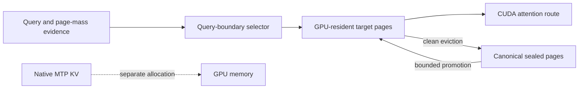

# ACO: Attention-Aware Context Offloading

ACO is an experimental CUDA path for keeping a bounded target-model KV working
set on the GPU while retaining sealed target pages in host memory. The default
`--kv-pager off` path is unchanged. ACO is not a general replacement for dense
attention, and `--kv-pager selective` is an approximation: pages outside the
selected set do not contribute to that attention result.

## Architecture



Target K/V is divided into logical pages. The pager keeps a bounded hot set on
the GPU, while canonical sealed pages and their metadata live in pageable host
memory. A pinned transfer ring stages bounded copies. Clean eviction can drop
device residency after host backing and the routing summary are current. The
pager does not own recurrent state or native MTP K/V; native MTP uses a separate
full-context allocation when enabled.

Attention evidence and retrieval determine which history pages are selected at
a query boundary. The selected history is frozen for that turn. A page being
resident is not proof that a particular attention operation read it; residency,
selection, and actual kernel execution are separate facts. For an eligible
CUDA shape, execution can use contiguous dense Flash Attention, a packed
selected-page view followed by mature Turbo4 Flash Attention, or the direct
paged Turbo4 kernel. `selected_reference` is an explicit correctness
diagnostic. It is not an automatic fallback and its timing is not performance
evidence.

For ordinary runs, leave `LLAMA_KV_ATTENTION_ROUTE` unset (its default is
`auto`). This process-wide diagnostic override can force `reference`, `dense`,
`packed`, or `direct` dispatch when the requested route passes capability
checks; unsupported overrides fail closed. Do not carry a diagnostic override
into production measurements or deployments.

## Supported shape and limits

The documented target geometry is Qwen3.8-family CUDA attention with 256-token
pages, 16 full-attention layers, 4 KV heads, K/V width 256, and Turbo4 K/V
(4.125 bits/value). A complete cross-layer target page is 4,325,376 encoded
bytes (4.125 MiB). The current documented execution boundary is causal,
batch-one CUDA attention. Do not infer support for Qwen3Next or other model
families from this geometry.

Selective routing can differ from full-context dense output and needs
model-and-prompt quality evaluation. It is not dense-equivalent. CUDA
correctness for a selected route does not establish output quality relative to
dense attention. Likewise, a page being GPU-resident does not establish that
it was attended in a measured request.

The hot-page count is a cap resolved against the target context and runtime
memory ledger. GPU memory must also fit model weights, graph and scratch space,
recurrent state, transfer staging, and any native MTP allocation. Host RAM must
fit the sealed-page backing and metadata. Pinned memory is separately bounded
by the transfer ring. `--fit off` disables automatic fitting; use it only when
you have checked the complete allocation on the target device. Unsupported
shapes, missing host backing, stale identities, unsafe eviction, or inadequate
capacity are refused rather than routed through CPU Turbo4 attention.

With an explicit `--kv-hot-pages` cap, the startup plan does not reserve a
worst-case copy of every optional packed-route workspace. Those buffers are
admitted at the route/graph boundary against their actual shape. A failed
scratch or graph allocation is surfaced as a refusal/error; successful startup
alone is not a guarantee that every later route allocation will fit.

The available modes are `off`, `observe`, `selective`, and `exact`. `off` is
the normal dense path. `observe` collects pager evidence without selective
eviction. `selective` enables the supported selective route. `exact` requires
its exact-mode invariants and fails closed when they are not met. The optional
`--kv-router probe-rerank` selects query-boundary reranking; the default is
`legacy`.

## Build

Use the CUDA toolkit and CMake versions required by
[`docs/build.md`](build.md#cuda). Configure a Release build for the local CUDA
architecture and build the server:

```bash
cmake -B build-aco \
  -DGGML_CUDA=ON \
  -DCMAKE_BUILD_TYPE=Release \
  -DCMAKE_CUDA_ARCHITECTURES=native
cmake --build build-aco --target llama-server --parallel 16
```

The resulting executable is `build-aco/bin/llama-server`. Use a supported
CUDA device and a Qwen3.8-family model with the documented KV geometry. The
generic build command does not imply that every CUDA card can hold a particular
model, hot set, or MTP allocation.

## Launch

The following is a validation configuration for a CUDA device with enough
memory for the complete model, runtime, a 64K-token target hot set, and
full-context native MTP. It is not a universal preset. With 256-token pages,
`--kv-hot-pages 256` caps the target hot set at 65,536 tokens. A model path and
API-key file must be supplied by the operator:

```bash
MODEL=/path/to/qwen3.8-model.gguf
API_KEY_FILE=/path/to/llama-api-keys

build-aco/bin/llama-server \
  -m "$MODEL" \
  --host 127.0.0.1 \
  --api-key-file "$API_KEY_FILE" \
  --device CUDA0 \
  -ngl 999 \
  --fit off \
  -fa on \
  -c 262144 \
  -b 1024 \
  -ub 256 \
  -np 1 \
  -ctk turbo4 \
  -ctv turbo4 \
  --spec-type draft-mtp \
  --spec-draft-n-max 2 \
  --spec-draft-kv-device gpu \
  -ctkd turbo4 \
  -ctvd turbo4 \
  --kv-pager selective \
  --kv-router probe-rerank \
  --kv-page-size 256 \
  --kv-hot-pages 256 \
  --no-context-shift \
  --ctx-checkpoints 0 \
  --cache-ram 0 \
  --no-cache-idle-slots
```

For a smaller smoke configuration, use `-c 8192 --kv-hot-pages 16`, omit the
native-MTP options, and make sure the model itself fits the selected device.
This still requires the documented model geometry; it does not establish
quality or speed for a full-context run.

For API-key setup, choose a private file containing one key per line and pass
its path through `--api-key-file`. Keep the server bound to `127.0.0.1` unless
you have separately configured network access and authentication.

## Evidence and comparisons

Treat routing counters, residency snapshots, attention execution, quality, and
latency as distinct measurements. The current 107-02 natural A/B/A cohort does
not provide cold-promotion timing; 107-01 cold-promotion timing was invalidated.
Two correct near-256K promotions from the earlier 105-21 cohort remain valid
for that older cohort only. Do not present those results as current-cohort
timings or as a general 256K guarantee.

The [portable reproduction protocol](../tools/server/bench/release_evidence/README.md)
and [matrix runner](../tools/server/bench/release_evidence/run_release_matrix.py)
are versioned with the source.
The valid 107-02 natural 8K/4K recall row measured 2,447.379 ms HTTP wall time,
638.308 ms prompt stage, 1,801.590 ms decode stage, and 34,603,008 useful H2D
bytes. This is one row, not a general speedup claim or a cold-promotion timing;
identical-body repeats were mixed controls with secondary page movement (about
2,281/2,275 ms). The older 105-21 cohort has two rubric-correct promotions
near 256K with about 33 MiB transferred; its 5,132/5,117 microsecond values are
transfer-stage timings only, not end-to-end latency. `107-01` is excluded in
full. See the reproduction README for tested inputs, controls, and
interpretation boundaries.

CPU-target F16 versus CUDA-target Turbo4 changes both placement and KV
representation, so it is a confounded comparison and cannot isolate the
offloading effect. Report the exact model, quantization, context, occupied
tokens, hot-page count, KV types, native-MTP placement, device, and executed
attention route with any comparison. Do not infer fully occupied context from
an allocation or configuration that only started successfully.

This implementation and documentation were developed with AI assistance and
require human review before contribution.
